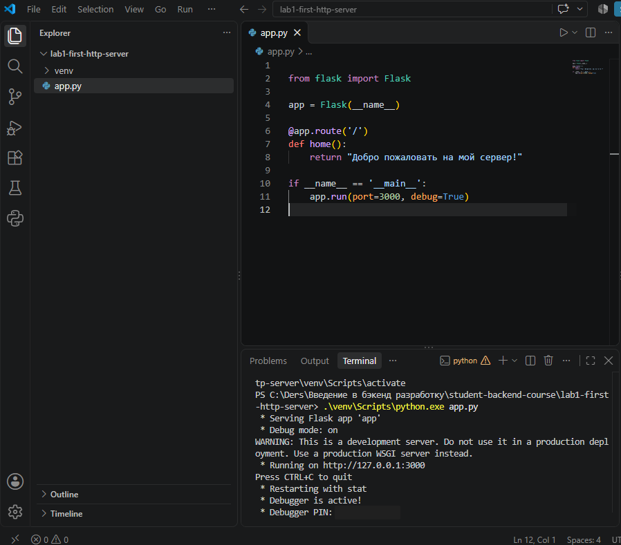
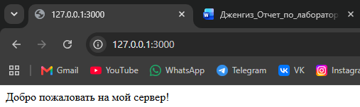
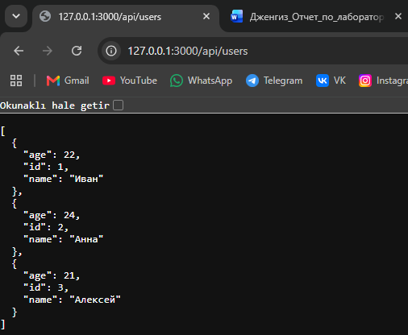
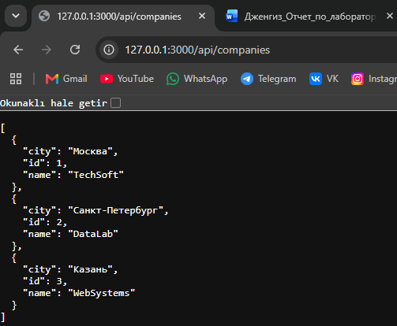
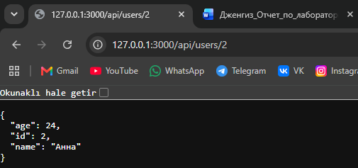
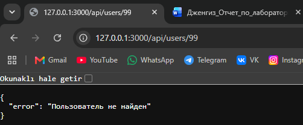
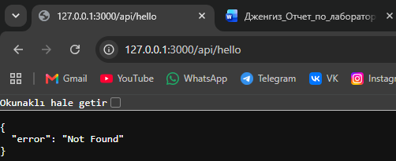
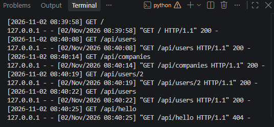
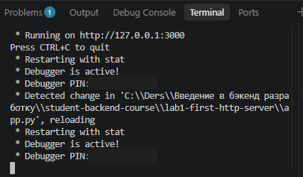

# Лабораторная работа № 1. Настройка среды разработки и первый HTTP-сервер

**Студент:** Дженгиз Атакан  
**Группа:** ПИЖ-б-о-25-1  
**Вариант:** 2  
**Уровень:** повышенный  
**Технология:** Python + Flask

## Содержание

1. [Цель работы](#1-цель-работы)
2. [Теоретическое обоснование](#2-теоретическое-обоснование)
3. [Выполнение практического примера](#3-выполнение-практического-примера)
4. [Выполнение индивидуального задания](#4-выполнение-индивидуального-задания)
5. [Ответы на контрольные вопросы](#5-ответы-на-контрольные-вопросы)
6. [Вывод](#6-вывод)
7. [Список использованных источников](#7-список-использованных-источников)

## 1. Цель работы

Освоить подготовку среды для бэкенд-разработки, создать и запустить простой HTTP-сервер на Python с использованием Flask. Научиться обрабатывать GET-запросы, возвращать текстовые и JSON-ответы, использовать параметры URL, обрабатывать ошибку 404, записывать входящие запросы в консоль и настраивать автоматический перезапуск сервера.

## 2. Теоретическое обоснование

Бэкенд — это серверная часть веб-приложения. Она принимает запросы клиентов, выполняет необходимую обработку и отправляет ответы. В архитектуре «клиент — сервер» браузер выступает клиентом: он отправляет HTTP-запрос, а сервер возвращает HTTP-ответ. Для получения данных обычно используется метод GET.

Эндпоинт — это адрес ресурса, к которому клиент обращается с определённым HTTP-методом. Маршрутизация позволяет связать адрес запроса с функцией в программе. Например, маршрут `/api/users` возвращает список пользователей. JSON (JavaScript Object Notation) — текстовый формат представления структурированных данных, который часто применяется при разработке API.

Для выполнения работы выбран Python и веб-фреймворк Flask. Flask позволяет создавать маршруты, формировать JSON-ответы и обрабатывать ошибки. Режим `debug=True` обеспечивает автоматический перезапуск сервера после изменения кода. Для логирования входящих запросов применяется декоратор `@app.before_request`.

## 3. Выполнение практического примера

### 3.1. Подготовка среды

Для выполнения работы установлены Python, Visual Studio Code и расширение Python для VS Code. В каталоге `lab1-first-http-server` создано виртуальное окружение и установлен Flask.

Команды, использованные в терминале PowerShell:

```powershell
py -m venv venv
.\venv\Scripts\python.exe -m pip install flask
```

Для запуска сервера использована команда:

```powershell
.\venv\Scripts\python.exe app.py
```

### 3.2. Первый HTTP-сервер

Сначала был создан минимальный сервер с текстовым ответом на корневом маршруте `/`:

```python
from flask import Flask

app = Flask(__name__)

@app.route('/')
def home():
    return "Добро пожаловать на мой сервер!"

if __name__ == '__main__':
    app.run(port=3000, debug=True)
```

После запуска в терминале появилось сообщение о работе сервера по адресу `http://127.0.0.1:3000`. При открытии этого адреса в браузере отобразился текст «Добро пожаловать на мой сервер!».

**Запуск сервера:**



**Текстовый ответ на корневом маршруте:**



## 4. Выполнение индивидуального задания

**Вариант 2, повышенный уровень.** По условию необходимо создать текстовый маршрут, две коллекции в JSON (`/api/users` и `/api/companies`), параметризованный маршрут `/api/users/<int:user_id>`, обработчик ошибки 404, автоматический перезапуск и логирование входящих запросов.

Для проверки использованы статические данные трёх пользователей и трёх компаний. База данных на данном этапе не требуется.

### 4.1. Итоговый код сервера (`app.py`)

```python
from flask import Flask, jsonify, request
import time

app = Flask(__name__)
app.json.ensure_ascii = False


# Данные пользователей
users = [
    {"id": 1, "name": "Иван", "age": 22},
    {"id": 2, "name": "Анна", "age": 24},
    {"id": 3, "name": "Алексей", "age": 21}
]


# Данные компаний
companies = [
    {"id": 1, "name": "TechSoft", "city": "Москва"},
    {"id": 2, "name": "DataLab", "city": "Санкт-Петербург"},
    {"id": 3, "name": "WebSystems", "city": "Казань"}
]


# Логирование входящих HTTP-запросов
@app.before_request
def log_request():
    print(f"[{time.strftime('%Y-%m-%d %H:%M:%S')}] {request.method} {request.path}")


# 1. Главная страница
@app.route('/')
def home():
    return "Добро пожаловать на мой сервер!"


# 2. Список всех пользователей
@app.route('/api/users')
def get_users():
    return jsonify(users)


# 3. Список всех компаний
@app.route('/api/companies')
def get_companies():
    return jsonify(companies)


# 4. Получение пользователя по ID
@app.route('/api/users/<int:user_id>')
def get_user(user_id):
    for user in users:
        if user["id"] == user_id:
            return jsonify(user)

    return jsonify({"error": "Пользователь не найден"}), 404


# 5. Обработка ошибки 404
@app.errorhandler(404)
def not_found(error):
    return jsonify({"error": "Not Found"}), 404


if __name__ == '__main__':
    app.run(port=3000, debug=True)
```

В программе используется настройка `app.json.ensure_ascii = False`, чтобы кириллические символы корректно отображались в JSON-ответах. Обработчик 404 возвращает JSON для неопределённых маршрутов, а при отсутствии пользователя предусмотрено отдельное сообщение об ошибке.

### 4.2. Проверка эндпоинтов

| Запрос | Назначение | Результат |
|---|---|---|
| `GET /` | Главная страница | Текст, HTTP 200 |
| `GET /api/users` | Список пользователей | JSON, HTTP 200 |
| `GET /api/companies` | Список компаний | JSON, HTTP 200 |
| `GET /api/users/2` | Пользователь с ID 2 | JSON с данными Анны, HTTP 200 |
| `GET /api/users/99` | Несуществующий пользователь | JSON с сообщением об ошибке, HTTP 404 |
| `GET /api/hello` | Несуществующий маршрут | `{"error": "Not Found"}`, HTTP 404 |

**Список пользователей:**



**Список компаний:**



**Получение пользователя по ID:**



**Проверка отсутствующего пользователя:**



**Обработка неизвестного маршрута:**



### 4.3. Логирование запросов

Перед обработкой каждого запроса функция `log_request()` записывает в терминал дату, время, HTTP-метод и путь запроса. При проверке были получены записи для успешных запросов и для неизвестного маршрута с кодом 404.



### 4.4. Автоматический перезапуск

Сервер запущен с параметром `debug=True`. После изменения комментария в `app.py` и сохранения файла Flask автоматически обнаружил изменение и перезапустил приложение. Для подтверждения сохранён снимок терминала.



### 4.5. Установка зависимостей

Для установки зависимостей из файла `requirements.txt` в подготовленном виртуальном окружении можно выполнить:

```powershell
.\venv\Scripts\python.exe -m pip install -r requirements.txt
```

Каталог `venv/` не включается в репозиторий: он создаётся локально, а список необходимых пакетов хранится в `requirements.txt`.

## 5. Ответы на контрольные вопросы

**1. Что такое клиент-серверная архитектура?**  
Это модель взаимодействия, в которой клиент отправляет запрос, а сервер обрабатывает его и возвращает ответ. В этой работе клиентом был браузер, а сервером — приложение Flask.

**2. Какой протокол используется для общения клиента и сервера в вебе?**  
Основным протоколом является HTTP. При защищённом соединении используется HTTPS.

**3. Что такое эндпоинт?**  
Эндпоинт — это сочетание HTTP-метода и адреса, по которому доступен определённый ресурс или функция API. Пример: `GET /api/users`.

**4. Какую структуру имеют HTTP-запрос и HTTP-ответ? Что такое код состояния?**  
Запрос содержит метод, адрес, версию протокола, заголовки и при необходимости тело. Ответ содержит код состояния, заголовки и, при необходимости, тело. Код состояния показывает результат обработки запроса, например 200 — успешно, 404 — ресурс не найден.

**5. Что такое JSON и почему он популярен?**  
JSON — текстовый формат представления данных в виде объектов, массивов и значений. Он удобен для передачи структурированных данных между сервером и клиентом, а также поддерживается многими языками программирования.

**6. Как запустить сервер на Flask?**  
Нужно установить Flask, создать приложение и вызвать `app.run()`. В данной работе сервер запускался командой `.\venv\Scripts\python.exe app.py` и использовал порт 3000.

**7. Что такое автоматический перезапуск и зачем он нужен?**  
Это повторный запуск сервера после изменения исходного кода без ручного завершения и нового запуска. Во Flask для разработки можно использовать `debug=True`. В Node.js для этой задачи часто применяется пакет `nodemon`.

**8. Какие коды состояния HTTP вы знаете? Что означает 404?**  
200 означает успешный запрос, 201 — создание ресурса, 400 — некорректный запрос, 401 — необходимость аутентификации, 403 — запрет доступа, 404 — ресурс не найден, 500 — внутреннюю ошибку сервера.

**9. Что такое middleware в Express и декораторы запросов во Flask?**  
Middleware в Express — промежуточные функции, которые выполняются при обработке запроса. Во Flask декоратор `@app.before_request` позволяет выполнить функцию перед обработкой запроса. В данной работе он использовался для записи сведений о запросах в консоль.

**10. Как получить параметр из URL в выбранном фреймворке?**  
Во Flask параметр указывается в маршруте, например `@app.route('/api/users/<int:user_id>')`. Его значение передаётся в функцию `get_user(user_id)`, после чего можно найти запись с соответствующим ID.

## 6. Вывод

В ходе лабораторной работы была настроена среда разработки Python и Flask, создан и запущен HTTP-сервер. Были реализованы текстовый маршрут, JSON-ответы со списками пользователей и компаний, получение пользователя по ID и обработка ошибки 404. Также удалось настроить вывод сведений о входящих запросах в консоль и проверить автоматический перезапуск сервера при изменении кода.

Во время выполнения работы я разобрался, как клиент обращается к серверу по HTTP и как Flask связывает URL с функциями Python. При проверке JSON-ответов кириллические символы сначала отображались в виде Unicode-последовательностей. Проблема была решена настройкой `app.json.ensure_ascii = False`. Все основные запросы были проверены в браузере, а результаты сохранены в виде снимков экрана.

## 7. Список использованных источников

1. [Python — официальная документация](https://docs.python.org/3/)
2. [Flask — официальная документация](https://flask.palletsprojects.com/)
3. [HTTP — MDN Web Docs](https://developer.mozilla.org/en-US/docs/Web/HTTP)
4. [JSON — MDN Web Docs](https://developer.mozilla.org/en-US/docs/Learn_web_development/Core/Scripting/JSON)
5. [Visual Studio Code — документация Python](https://code.visualstudio.com/docs/python/python-tutorial)
